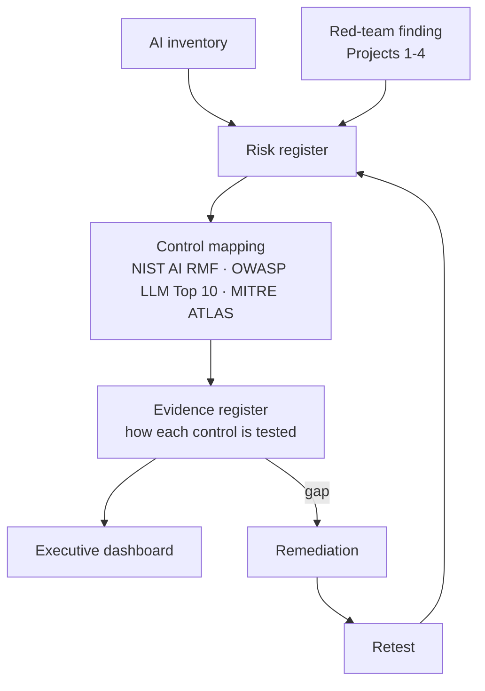

# AI Security & Governance Assurance

Connects technical AI-security work to business decisions — the skill that separates
senior candidates from junior ones. An AI inventory, a risk register, a control
mapping to recognised frameworks, an evidence register, and an executive dashboard,
with one real red-team finding traced end to end.

## What it produces

`python -m app.build` validates that every link resolves and writes:

- **GOVERNANCE.md** — the risk register and open actions.
- **dashboard.html** — a self-contained executive dashboard (risks, controls,
  evidence, the traceability thread), light/dark.

Live state: **4 AI systems, 5 tracked risks, 1 deliberately open** (the residual RAG
injection from Project 2 — tracked, not closed on paper).

## Components



- **Inventory** (`data/inventory.json`) — owner, purpose, model, data classification,
  users, integrations, risk tier for every AI system.
- **Risk register** (`data/risk_register.json`) — each risk, its likelihood/impact,
  treatment, linked control and retest evidence. Risks are sourced from the red-team
  findings in Projects 1–4.
- **Control mapping** (`data/control_mapping.json`) — control ↔ NIST AI RMF function
  ↔ OWASP LLM Top 10 ↔ MITRE ATLAS ↔ evidence.
- **Evidence register** (`data/evidence.json`) — how each control is tested and the
  proof it works, with last-tested dates.

## The traceability thread

[docs/TRACEABILITY.md](docs/TRACEABILITY.md): one Project-1 finding → logged risk →
mapped control → evidence → retest → closure. Demonstrated attack becoming a managed
business risk — the detail that elevates this above a stack of spreadsheets.

## Run it

```sh
python -m app.build                   # validate links, write report + dashboard
python -m unittest discover -s tests  # traceability integrity tests
```

## Portfolio checklist

- [x] AI inventory covering all four fictional systems
- [x] Risk register sourced from the Project 1–4 findings
- [x] Control mapping (control ↔ NIST AI RMF ↔ OWASP LLM Top 10 ↔ MITRE ATLAS)
- [x] Evidence register with retest proof and dates
- [x] Executive dashboard + one finding traced end to end
- [x] CI that validates traceability and rebuilds the dashboard on change
